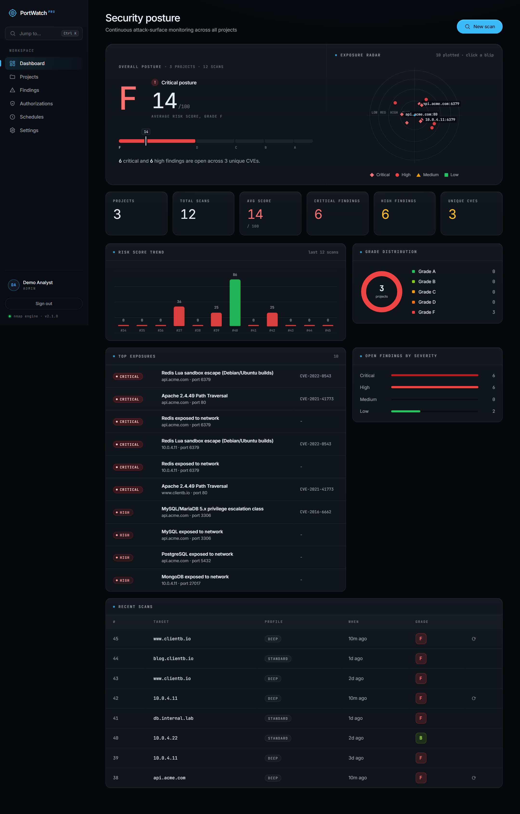
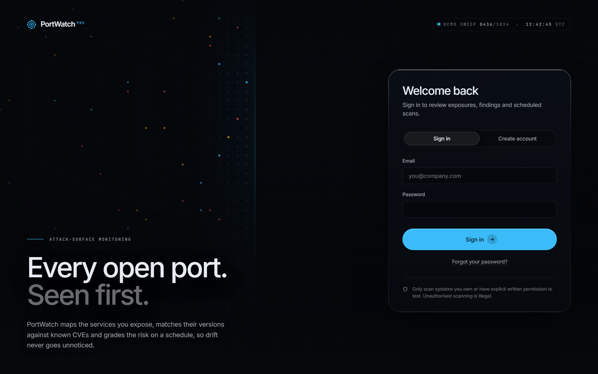
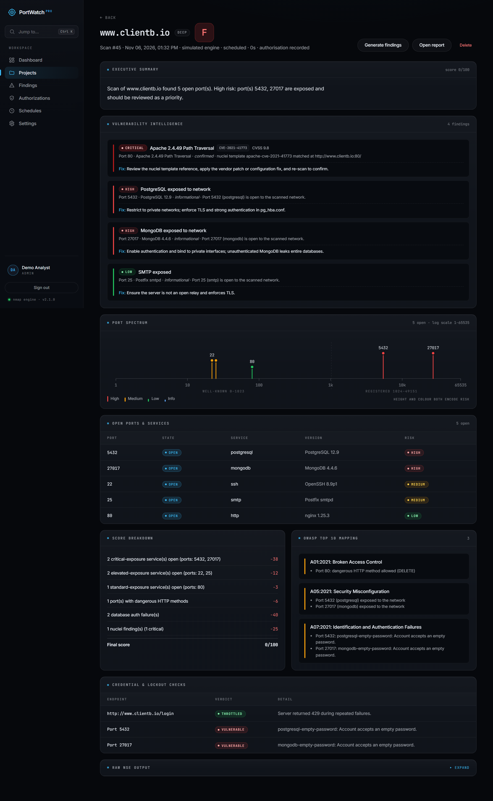
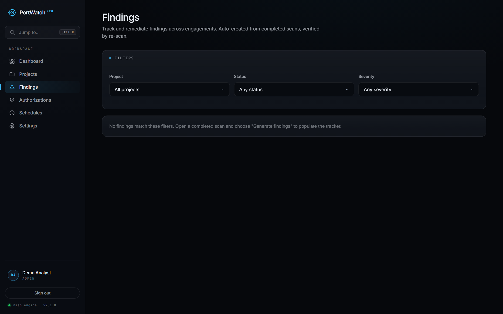
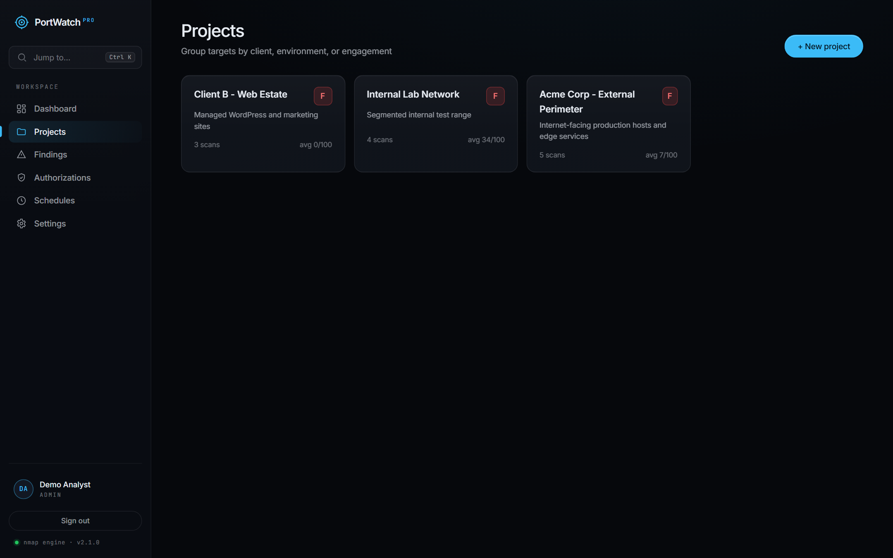

# PortWatch Pro

**Attack-surface monitoring platform.** PortWatch Pro scans hosts for exposed
ports and services, scores their risk in an explainable way, maps findings to
the OWASP Top 10, enriches them with CVE intelligence and remediation guidance,
tracks how a target's posture changes over time, and can re-scan on a schedule
with alerts, all behind a multi-user web application.

It began as **PortWatch**, a single-page nmap wrapper. Version 2.0 added the
product layer (accounts, projects, dashboard, schedules, intel, notifications,
reports, packaging). Version 2.1 is the hardening release: an authorisation
gate on every scan, background scan execution with cancel and timeouts, a
full token lifecycle, password reset, API keys, an audit log, rate limiting,
Alembic migrations, PostgreSQL support, and a CI-backed test suite.



---

## Interface

PortWatch Pro ships a redesigned dark-mode analyst console. The sign-in screen is
a live attack-surface scanner; the dashboard leads with a **posture hero** — the
overall grade, average score and an F→A meter — beside an **exposure radar** that
plots your real top exposures, with severity shown by ring, shape *and* colour so
it still reads for colour-blind users. A `Ctrl K` command palette jumps anywhere,
and every animation respects `prefers-reduced-motion`.

| | |
|---|---|
|  |  |
| **Sign in** — the port field is a live demo sweep. | **Scan detail** — port spectrum, nuclei-confirmed CVEs, a line-by-line score breakdown and OWASP mapping. |
|  |  |
| **Findings** — track and triage vulnerabilities through their remediation lifecycle. | **Projects** — targets grouped by client, environment or engagement. |

---

## What this pass added

The first versions of this project trusted their own output. The scanner graded a
host, and the only thing checking that grade was a corpus I had written from the
scanner's own behaviour. That is a circular check. It catches regressions, but it
can't tell you the scanner is actually right about a real machine. Most of this
pass went into checking the scanner against things that don't share its code.

**A real lab, scanned for real.** `docker/lab/` brings up six services in known
states: a hardened nginx, an Apache 2.4.49 box left open to CVE-2021-41773 on
purpose, an unauthenticated Redis, a no-auth MongoDB, an exposed Postgres, and a
plaintext FTP server. Each sits on its own loopback address, so scanning them is
allowed by construction (they run on my own machine). The harness in
`backend/tests/differential/` runs the real nmap engine against that lab and
compares what it finds to a plain socket prober that shares no code with
PortWatch. If RustScan or naabu happens to be installed, it gets pulled in as a
third opinion. The run fails loudly when the lab and its manifest disagree, so a
half-booted container can't slip through. Details in `docs/DIFFERENTIAL.md`.

**The CVE data is checked against NVD.** The knowledge base used to assert CVSS
scores and version ranges on its own authority. `backend/tests/cve_validation.py`
now cross-checks every CVE it claims against the live NVD record, and the regex
version boundaries are pinned by positive and negative banner tables. That turned
up five real bugs in the matcher, all now fixed: three version-range off-by-ones
(it flagged Apache 2.4.49, OpenSSH 7.4, and ProFTPD 1.3.5a, which are the
*patched* releases) and two severity labels that disagreed with their own CVSS
score.

**The risk score now ranks the way an analyst would.** The old model sorted open
ports into three buckets, so a host with a pile of harmless ports could outscore
one running an exposed database. On the twelve-host reference corpus it disagreed
with the analyst ordering seven times. I replaced it with a per-service
criticality table: data stores weigh heaviest, cleartext and remote-admin next,
web and DNS lightest. The disagreements went to zero and the rank correlation to
-1.0. I want to be straight about that number. A perfect rank on twelve
hand-labelled hosts is a strong fit to that sample, not proof the model is right
in general. The live differential run is the out-of-sample test.

**The pentest layer actually works now.** The authorization, findings, asset, and
recon features had database tables and an API blueprint, but the ORM models were
missing and the blueprint was never registered, so those endpoints all returned
404. I added the four models, the missing auth decorators, and registered the
blueprints. Then I built the two screens that matter most: an authorizations page
(the consent gate, with an admin approval flow) and a findings tracker where you
can filter by project, status, and severity, change status and assignee, and
generate findings straight from a completed scan.

**Housekeeping.** The tree carried two copies of the core modules (scanner,
scoring, and the rest): one under `services/`, and a stale duplicate at the top
level that shadowed it whenever the import path wasn't set up just so. It had
already bitten me once mid-pass by regenerating a report from the wrong scoring
model. I deleted the dead copies so there is one source of truth. I also went back
through the frontend for accessibility: labels on the icon-only nav, a focus trap
in modals that restores focus on close, text alternatives on the charts, auth form
labels wired to their fields, and a skip link.

The suite sits at 180 passing, plus integration gates that stay skipped until
you bring up the lab (`PORTWATCH_LAB=1`) or allow the NVD lookup
(`PORTWATCH_NVD=1`).

### Scanner accuracy: discovery, confidence and nuclei

This pass widened what the scanner can see and made it say how sure it is. Every
new tool is optional. If it is not installed the scan runs exactly as before,
with no error and no warning. All of it sits behind the same authorisation gate
as every other scan.

**Discovery then detection.** nmap is good at identifying what a service is but
slow at covering many ports. Dedicated sweepers are the reverse. So when
`rustscan`, `naabu` or `masscan` is on the PATH, it sweeps a profile-defined
range first (quick: top 100 ports, standard: top 1000, deep: all 65535). nmap
`-sV` then runs only against the ports the sweeper found open. You get the wider
coverage at sweeper speed and keep nmap's service and version detection. Ports
that only the sweeper saw (nmap could not fingerprint them) still appear in the
results. With no sweeper installed, nmap scans its top-ports list as it always
did.

**Per-port confidence.** Every port now carries `seen_by` (the engines that saw
it open, for example `["nmap", "rustscan"]`) and `confidence`: `confirmed` when
two or more independent engines agree, `single-engine` otherwise. This tells you
how far to trust a detection. It is informational and is deliberately *not* fed
into the risk score, so the score stays deterministic and auditable.

**nuclei integration.** An open port says little about whether anything is
actually wrong. After services are found, `nuclei` runs templated checks against
the open web services (HTTPS is assumed on 443, 8443 and 9443, HTTP otherwise).
Findings at or above the configured severity feed the risk score as one
severity-weighted line (critical 25, high 18, medium 8, low 3 points), capped at
45 so a noisy template set cannot zero a host. They appear in the CVE
intelligence list with `confirmed` confidence, because a tool matched them
rather than a banner guess, and are attached to the matching port's `scripts`
output as `nuclei:<template-id>`.

**NSE scripts.** The NSE bundle was expanded with protocol-level checks that
nuclei's web templates do not cover: `ssl-poodle` on TLS ports, `ftp-anon` on
port 21, and `smb-os-discovery` / `smb-vuln-ms17-010` on port 445. Nuclei adds
the broader web template coverage on top.

**Graceful degradation.** A missing sweeper, a missing nuclei, a tool that
fails or times out, or a malformed output line all fall back silently to the
previous behaviour. Cancelling a scan is still honoured between stages. In
simulation mode, `seen_by` and nuclei findings are generated deterministically
per target so the whole feature is demonstrable without any tools.

New environment variables:

| Variable | Default | Purpose |
|----------|---------|---------|
| `PORTWATCH_PORT_SWEEPER` | `auto` | `auto` uses the first of rustscan, naabu, masscan found on PATH; name one to force it; `off` disables the sweep stage |
| `PORTWATCH_NUCLEI` | `auto` | `auto` runs nuclei if installed; `off` disables it |
| `PORTWATCH_NUCLEI_SEVERITY` | `low` | Lowest severity kept (`info`, `low`, `medium`, `high`, `critical`) |
| `PORTWATCH_NUCLEI_TAGS` | empty | Comma-separated nuclei template tags to restrict the run (empty runs the default templates) |
| `PORTWATCH_NUCLEI_TIMEOUT` | `600` | nuclei run timeout in seconds |

---

## Why it exists

Organisations lose track of what they expose to the internet. A port opened for
a one-off test, a database bound to `0.0.0.0`, a web server missing security
headers: each is an easy foothold. PortWatch Pro gives a small team a single
place to **discover exposure, understand its severity, and watch it over time**,
with reports they can hand to a client.

---

## Features

| Area | What it does |
|------|--------------|
| **Scanning** | Two-phase nmap engine, three depth profiles (quick / standard / deep), NSE web + database scripts, TCP connect or SYN mode. Falls back to a realistic **simulation engine** when nmap is not installed, so it demos anywhere. |
| **Discovery then detection** | An optional fast port sweeper (rustscan, naabu or masscan, auto-detected) finds open ports across a wider range, then nmap `-sV` fingerprints only those. Deep scans can cover all 65535 ports. |
| **Per-port confidence** | Each port reports which engines saw it (`seen_by`) and a `confidence` of `confirmed` or `single-engine`. Informational only; it does not change the risk score. |
| **nuclei checks** | Optional templated vulnerability checks against open web services. Findings are scored (severity-weighted, capped) and listed as confirmed intel entries. |
| **Background execution** | Every scan runs in a worker pool, not the request. The UI polls, shows live status, and can cancel. Each profile has a hard time ceiling. |
| **Authorisation gate** | A scan is refused unless the requester confirms authorisation; consent is stored with the scan and audited. Projects can carry a target allowlist that scans and schedules must stay inside. |
| **Risk scoring** | Deterministic, auditable 100-point model with letter grades (A to F). Every deduction is shown line by line. |
| **Vulnerability intelligence** | Detected services and script hits are matched to real CVEs (with CVSS) and exposure guidance, each with a confidence level and a concrete fix. |
| **Compliance mapping** | Findings mapped to OWASP Top 10 (2021) categories with evidence. |
| **Credential & lockout checks** | Opt-in: probes login endpoints for rate limiting or lockout and runs DB default-credential scripts. |
| **Projects** | Group targets by client, environment, or engagement, with an optional scope allowlist. |
| **Dashboard** | KPIs, risk-score trend, grade distribution, top exposures, severity roll-up. |
| **Scheduled scans** | Recurring scans on an interval for continuous monitoring, run by a background scheduler through the same queue. |
| **Notifications** | Email and webhook (Slack-compatible) alerts when a scan grades at or below a threshold. |
| **Scan comparison** | Diff any two scans of a target: ports opened or closed, service changes, score movement. |
| **Reporting** | One-click branded HTML report, print-to-PDF ready, with the intel and OWASP sections included. |
| **Accounts** | Register and login with scrypt-hashed passwords, 1-hour access tokens with rotating refresh tokens, sign out everywhere, change and reset password, revocable API keys for scripted scanning. |
| **Findings tracker** | Turns a completed scan's intelligence into tracked findings and works them through a remediation lifecycle. Filter by project, status or severity, reassign them, and verify fixes against a later scan. |
| **Authorizations** | A signed engagement consent record per project. Active tests run only against a target that an approved, in-date authorization covers; non-admins file one and an admin approves it. |
| **Audit log** | Append-only record of every auth event, scan, project, schedule and channel change, with actor and IP. Admins see all users. |
| **Operations** | Rate limiting on login, register, reset and scan; security headers; production mode that refuses the default secret; Alembic migrations; PostgreSQL profile with nightly backups; GitHub Actions CI. |

---

## Architecture

```
Frontend SPA (vanilla JS, hash router)
        |  REST + JWT / API key
Flask API (application factory + blueprints)
        |
Services: scanner . scoring . compliance . diffing . authtest
          cve_intel . scan_service . scan_jobs . scheduler . notifier . report . audit
        |
SQLAlchemy + Alembic: SQLite (dev) or PostgreSQL (prod)
  users . projects . scans . schedules . channels . refresh_tokens
  password_reset_tokens . api_keys . audit_log
```

The original scan engine (scoring, compliance, diffing, credential testing) is
**preserved** and wrapped by a thin orchestration service so a manual scan, an
API-key scan and a scheduled scan all take exactly the same path. See
[`docs/ARCHITECTURE.md`](docs/ARCHITECTURE.md) for the design,
[`docs/THREAT_MODEL.md`](docs/THREAT_MODEL.md) for security and responsible
use, [`docs/DEPLOYMENT.md`](docs/DEPLOYMENT.md) for running it in production,
and [`docs/BUILD_LOG.md`](docs/BUILD_LOG.md) for the phase-by-phase record.

---

## Quick start

### Option A: Docker (includes nmap, real scans work)

```bash
cp .env.example .env            # set PORTWATCH_SECRET at minimum
docker compose up --build       # SQLite in a volume
# or, with PostgreSQL and nightly backups:
docker compose --profile postgres up --build
# open http://localhost:5000
```

### Option B: Local Python

```bash
cd backend
python -m venv venv && source venv/bin/activate   # Windows: venv\Scripts\activate
pip install -r requirements.txt

# Optional: install nmap for real scans (nmap.org). Without it, the app
# automatically runs in simulation mode.

python seed.py        # creates demo data + a demo login (optional)
python app.py         # http://localhost:5000
```

**Demo login (after `seed.py`):** `demo@portwatch.io` / `demopass123`

If you skip `seed.py`, click **Create account**; the first account becomes the
admin. The schema is created and migrated automatically on first boot.

---

## Simulation vs live scanning

PortWatch Pro detects whether `nmap` is on the PATH:

- **nmap present**: real scans against the target you enter, using TCP connect
  scans by default (`PORTWATCH_NMAP_SCAN_TYPE=syn` for SYN scans, which need
  root or `CAP_NET_RAW`).
- **nmap absent** (or `PORTWATCH_SIMULATE=1`): a deterministic simulation
  engine produces realistic, varied scan results in the identical data shape.
  The same target always looks the same, so diffs and trends behave sensibly.

This means the entire product is fully demonstrable on any laptop with no root
access and no nmap install. The engine badge in the sidebar shows which mode is
active, and `tests/test_real_engine.py` pins the real engine to the same output
contract as the simulation.

> **Legal:** Only scan systems you own or have explicit written permission to
> test. Unauthorised scanning is illegal. The application requires that
> confirmation on every scan and records it. See `docs/THREAT_MODEL.md`.

---

## Configuration

All via environment variables (full table in `docs/DEPLOYMENT.md`). The ones
you will meet first:

| Variable | Default | Purpose |
|----------|---------|---------|
| `PORTWATCH_ENV` | `development` | `production` refuses the dev secret and locks down CORS |
| `PORTWATCH_SECRET` | dev value | JWT signing secret. **Required in production** |
| `PORTWATCH_JWT_HOURS` | 1 | Access-token lifetime (refresh tokens last `PORTWATCH_REFRESH_DAYS`, 30) |
| `PORTWATCH_DB_URI` | local SQLite | SQLAlchemy URL; use `postgresql+psycopg://...` for Postgres |
| `PORTWATCH_SIMULATE` | off | Force simulated scans |
| `PORTWATCH_NMAP_SCAN_TYPE` | `connect` | `connect` or `syn` |
| `PORTWATCH_SCHEDULER` | on | Enable the background scheduler |
| `PORTWATCH_PORT_SWEEPER`, `PORTWATCH_NUCLEI`, `PORTWATCH_NUCLEI_*` | `auto` | Optional sweeper and nuclei integration (see *Scanner accuracy* above) |
| `PORTWATCH_SMTP_*` | unset | SMTP for email alerts and password-reset mail (webhooks work without it) |

---

## API overview

All endpoints under `/api`. Everything except `auth/register`, `auth/login`,
`auth/refresh`, `auth/forgot`, `auth/reset` and `health` requires
`Authorization: Bearer <access token>`, or an API key as
`Authorization: Bearer pwp_...` / `X-API-Key: pwp_...`.

```
POST /api/auth/register        POST /api/auth/login         GET  /api/auth/me
POST /api/auth/refresh         POST /api/auth/logout        POST /api/auth/logout-all
POST /api/auth/password        POST /api/auth/forgot        POST /api/auth/reset
GET/POST /api/auth/api-keys    DELETE /api/auth/api-keys/<id>
GET  /api/projects             POST /api/projects           GET/PATCH/DELETE /api/projects/<id>
POST /api/scan  (202 queued; ?wait=1 blocks up to 25 s)     GET  /api/scans[?project_id=&status=]
GET/DELETE /api/scans/<id>     POST /api/scans/<id>/cancel  GET  /api/scans/<a>/diff/<b>
GET  /api/scans/<id>/report    GET  /api/profiles
GET  /api/dashboard            GET  /api/audit[?action=&limit=]
GET  /api/schedules            POST /api/schedules          PATCH/DELETE /api/schedules/<id>
POST /api/schedules/<id>/run
GET  /api/notifications        POST /api/notifications      PATCH/DELETE /api/notifications/<id>
POST /api/notifications/<id>/test
GET  /api/health
```

A scan request must include `"authorised": true`. Scripted example:

```bash
curl -H "X-API-Key: pwp_..." -H "Content-Type: application/json" \
     -d '{"project_id":1,"target":"scanme.example","profile":"quick","authorised":true}' \
     "https://portwatch.example.com/api/scan?wait=1"
```

---

## Testing

```bash
cd backend
pip install -r requirements-dev.txt
python test_backend.py          # pytest suite + coverage summary
# or
python -m pytest tests -q
```

180 tests run by default and cover API flow and ownership isolation, the
authorisation gate and allowlists, the pentest authorization and credential-spray
gates, token lifecycle, password reset, API keys, rate limiting, the audit log,
background jobs (polling, cancel, timeout, scheduler), the real nmap engine
through a fake PortScanner, migrations (fresh, legacy 2.0, round trip), and the
scoring, CVE-regex, diffing, and notification units.

A handful of integration tests stay skipped unless you ask for them, because they
reach outside the process. `PORTWATCH_LAB=1` turns on the differential run and the
port-sweep / nuclei checks against the Docker lab (they need nmap, a sweeper or
nuclei, and the lab up), and `PORTWATCH_NVD=1` turns on the NVD cross-check (it
needs network). Both are wired into CI as their own jobs.

`.github/workflows/ci.yml` runs three jobs on push. The first runs the full
suite on Python 3.11 and 3.12. The second installs nmap, brings up the reference
lab, waits for every service to answer, and runs the differential gate, then
uploads the report it generates. The third runs the NVD cross-check against the
live API.

---

## Project layout

```
portwatch-pro/
├── backend/
│   ├── app.py               # application factory + entry point (gunicorn app:app)
│   ├── seed.py              # demo data
│   ├── test_backend.py      # test runner wrapper (pytest + coverage)
│   ├── alembic.ini          # migrations config
│   ├── migrations/          # Alembic env + versions (0001 baseline, 0002 hardening)
│   ├── core/                # config, security (JWT/refresh/API keys), ratelimit, migrate
│   ├── models/              # SQLAlchemy models
│   ├── api/                 # blueprints (auth, projects, scans, dashboard, schedules, notifications, audit)
│   ├── services/            # engine, port_sweep, nuclei_scan, scoring, intel, scan_service, scan_jobs, scheduler, notifier, report, audit
│   └── tests/               # pytest suite
├── frontend/                # SPA (index.html, css/, js/, assets/)
├── docker/                  # Dockerfile, backup.sh
├── docker-compose.yml       # app + optional postgres/backup profile
├── .github/workflows/ci.yml
└── docs/                    # ARCHITECTURE, THREAT_MODEL, DEPLOYMENT, BUILD_LOG, REMAINING_WORK, screenshots/
```

---

## License / attribution

Built on the original PortWatch scanner. Intended for authorised security
assessment and educational use.
