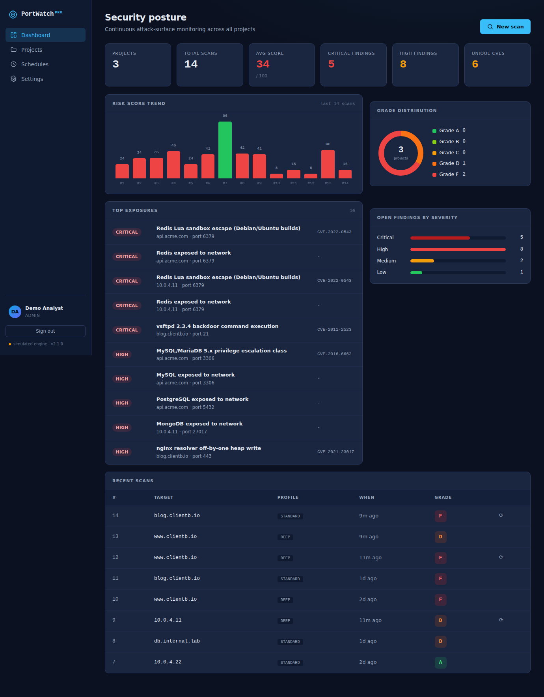

# PortWatch Pro

**Attack-surface monitoring platform.** PortWatch Pro scans hosts for exposed
ports and services, scores their risk in an explainable way, maps findings to
the OWASP Top 10, enriches them with CVE intelligence and remediation guidance,
tracks how a target's posture changes over time, and can re-scan on a schedule
with alerts, all behind a multi-user web application.

It began as **PortWatch**, a single-page nmap wrapper. Version 2.0 added the
product layer (accounts, projects, dashboard, schedules, intel, notifications,
reports, packaging). Version 2.1 is the hardening release: an authorisation
gate on every scan, background scan execution with cancel and timeouts, a
full token lifecycle, password reset, API keys, an audit log, rate limiting,
Alembic migrations, PostgreSQL support, and a CI-backed test suite.

> **v2.2 hardening & quality pass.** A safe-by-default posture across the
> platform: the authorisation gate now requires explicit approval by a second
> user (no self-approval); a target guard refuses loopback, link-local, and
> cloud-metadata destinations and, by default, private ranges; credential
> spraying simulates unless deliberately enabled and needs per-run consent; a
> strict Content-Security-Policy, HSTS, request-size limits, request IDs, a
> readiness probe, and accessibility improvements were added. Test suite grew
> to 130 passing. See `CHANGELOG.md` and `docs/ITERATION_LOG.md`.
>
> Sensitive capabilities are off until an operator opts in:
> `LIVE_CREDENTIAL_TESTING=1` for live credential testing and
> `ALLOW_PRIVATE_TARGETS=1` for internal ranges. Loopback and cloud-metadata
> endpoints stay blocked regardless.



---

## Why it exists

Organisations lose track of what they expose to the internet. A port opened for
a one-off test, a database bound to `0.0.0.0`, a web server missing security
headers: each is an easy foothold. PortWatch Pro gives a small team a single
place to **discover exposure, understand its severity, and watch it over time**,
with reports they can hand to a client.

---

## Features

| Area | What it does |
|------|--------------|
| **Scanning** | Two-phase nmap engine, three depth profiles (quick / standard / deep), NSE web + database scripts, TCP connect or SYN mode. Falls back to a realistic **simulation engine** when nmap is not installed, so it demos anywhere. |
| **Background execution** | Every scan runs in a worker pool, not the request. The UI polls, shows live status, and can cancel. Each profile has a hard time ceiling. |
| **Authorisation gate** | A scan is refused unless the requester confirms authorisation; consent is stored with the scan and audited. Projects can carry a target allowlist that scans and schedules must stay inside. |
| **Risk scoring** | Deterministic, auditable 100-point model with letter grades (A to F). Every deduction is shown line by line. |
| **Vulnerability intelligence** | Detected services and script hits are matched to real CVEs (with CVSS) and exposure guidance, each with a confidence level and a concrete fix. |
| **Compliance mapping** | Findings mapped to OWASP Top 10 (2021) categories with evidence. |
| **Credential & lockout checks** | Opt-in: probes login endpoints for rate limiting or lockout and runs DB default-credential scripts. |
| **Projects** | Group targets by client, environment, or engagement, with an optional scope allowlist. |
| **Dashboard** | KPIs, risk-score trend, grade distribution, top exposures, severity roll-up. |
| **Scheduled scans** | Recurring scans on an interval for continuous monitoring, run by a background scheduler through the same queue. |
| **Notifications** | Email and webhook (Slack-compatible) alerts when a scan grades at or below a threshold. |
| **Scan comparison** | Diff any two scans of a target: ports opened or closed, service changes, score movement. |
| **Reporting** | One-click branded HTML report, print-to-PDF ready, with the intel and OWASP sections included. |
| **Accounts** | Register and login with scrypt-hashed passwords, 1-hour access tokens with rotating refresh tokens, sign out everywhere, change and reset password, revocable API keys for scripted scanning. |
| **Audit log** | Append-only record of every auth event, scan, project, schedule and channel change, with actor and IP. Admins see all users. |
| **Operations** | Rate limiting on login, register, reset and scan; security headers; production mode that refuses the default secret; Alembic migrations; PostgreSQL profile with nightly backups; GitHub Actions CI. |

---

## Architecture

```
Frontend SPA (vanilla JS, hash router)
        |  REST + JWT / API key
Flask API (application factory + blueprints)
        |
Services: scanner . scoring . compliance . diffing . authtest
          cve_intel . scan_service . scan_jobs . scheduler . notifier . report . audit
        |
SQLAlchemy + Alembic: SQLite (dev) or PostgreSQL (prod)
  users . projects . scans . schedules . channels . refresh_tokens
  password_reset_tokens . api_keys . audit_log
```

The original scan engine (scoring, compliance, diffing, credential testing) is
**preserved** and wrapped by a thin orchestration service so a manual scan, an
API-key scan and a scheduled scan all take exactly the same path. See
[`docs/ARCHITECTURE.md`](docs/ARCHITECTURE.md) for the design,
[`docs/THREAT_MODEL.md`](docs/THREAT_MODEL.md) for security and responsible
use, [`docs/DEPLOYMENT.md`](docs/DEPLOYMENT.md) for running it in production,
and [`docs/BUILD_LOG.md`](docs/BUILD_LOG.md) for the phase-by-phase record.

---

## Quick start

### Option A: Docker (includes nmap, real scans work)

```bash
cp .env.example .env            # set PORTWATCH_SECRET at minimum
docker compose up --build       # SQLite in a volume
# or, with PostgreSQL and nightly backups:
docker compose --profile postgres up --build
# open http://localhost:5000
```

### Option B: Local Python

```bash
cd backend
python -m venv venv && source venv/bin/activate   # Windows: venv\Scripts\activate
pip install -r requirements.txt

# Optional: install nmap for real scans (nmap.org). Without it, the app
# automatically runs in simulation mode.

python seed.py        # creates demo data + a demo login (optional)
python app.py         # http://localhost:5000
```

**Demo login (after `seed.py`):** `demo@portwatch.io` / `demopass123`

If you skip `seed.py`, click **Create account**; the first account becomes the
admin. The schema is created and migrated automatically on first boot.

---

## Simulation vs live scanning

PortWatch Pro detects whether `nmap` is on the PATH:

- **nmap present**: real scans against the target you enter, using TCP connect
  scans by default (`PORTWATCH_NMAP_SCAN_TYPE=syn` for SYN scans, which need
  root or `CAP_NET_RAW`).
- **nmap absent** (or `PORTWATCH_SIMULATE=1`): a deterministic simulation
  engine produces realistic, varied scan results in the identical data shape.
  The same target always looks the same, so diffs and trends behave sensibly.

This means the entire product is fully demonstrable on any laptop with no root
access and no nmap install. The engine badge in the sidebar shows which mode is
active, and `tests/test_real_engine.py` pins the real engine to the same output
contract as the simulation.

> **Legal:** Only scan systems you own or have explicit written permission to
> test. Unauthorised scanning is illegal. The application requires that
> confirmation on every scan and records it. See `docs/THREAT_MODEL.md`.

---

## Configuration

All via environment variables (full table in `docs/DEPLOYMENT.md`). The ones
you will meet first:

| Variable | Default | Purpose |
|----------|---------|---------|
| `PORTWATCH_ENV` | `development` | `production` refuses the dev secret and locks down CORS |
| `PORTWATCH_SECRET` | dev value | JWT signing secret. **Required in production** |
| `PORTWATCH_JWT_HOURS` | 1 | Access-token lifetime (refresh tokens last `PORTWATCH_REFRESH_DAYS`, 30) |
| `PORTWATCH_DB_URI` | local SQLite | SQLAlchemy URL; use `postgresql+psycopg://...` for Postgres |
| `PORTWATCH_SIMULATE` | off | Force simulated scans |
| `PORTWATCH_NMAP_SCAN_TYPE` | `connect` | `connect` or `syn` |
| `PORTWATCH_SCHEDULER` | on | Enable the background scheduler |
| `PORTWATCH_SMTP_*` | unset | SMTP for email alerts and password-reset mail (webhooks work without it) |

---

## API overview

All endpoints under `/api`. Everything except `auth/register`, `auth/login`,
`auth/refresh`, `auth/forgot`, `auth/reset` and `health` requires
`Authorization: Bearer <access token>`, or an API key as
`Authorization: Bearer pwp_...` / `X-API-Key: pwp_...`.

```
POST /api/auth/register        POST /api/auth/login         GET  /api/auth/me
POST /api/auth/refresh         POST /api/auth/logout        POST /api/auth/logout-all
POST /api/auth/password        POST /api/auth/forgot        POST /api/auth/reset
GET/POST /api/auth/api-keys    DELETE /api/auth/api-keys/<id>
GET  /api/projects             POST /api/projects           GET/PATCH/DELETE /api/projects/<id>
POST /api/scan  (202 queued; ?wait=1 blocks up to 25 s)     GET  /api/scans[?project_id=&status=]
GET/DELETE /api/scans/<id>     POST /api/scans/<id>/cancel  GET  /api/scans/<a>/diff/<b>
GET  /api/scans/<id>/report    GET  /api/profiles
GET  /api/dashboard            GET  /api/audit[?action=&limit=]
GET  /api/schedules            POST /api/schedules          PATCH/DELETE /api/schedules/<id>
POST /api/schedules/<id>/run
GET  /api/notifications        POST /api/notifications      PATCH/DELETE /api/notifications/<id>
POST /api/notifications/<id>/test
GET  /api/health
```

A scan request must include `"authorised": true`. Scripted example:

```bash
curl -H "X-API-Key: pwp_..." -H "Content-Type: application/json" \
     -d '{"project_id":1,"target":"scanme.example","profile":"quick","authorised":true}' \
     "https://portwatch.example.com/api/scan?wait=1"
```

---

## Testing

```bash
cd backend
pip install -r requirements-dev.txt
python test_backend.py          # pytest suite + coverage summary
# or
python -m pytest tests -q
```

113 tests: API flow and ownership isolation, the authorisation gate and
allowlists, token lifecycle, password reset, API keys, rate limiting, audit
log, background jobs (polling, cancel, timeout, scheduler), the real nmap
engine through a fake PortScanner, migrations (fresh, legacy 2.0, round trip),
and unit tests for scoring boundaries, every CVE version regex, diffing and
notifications. Statement coverage is 88 percent; the remainder is live network
code (authtest probes, real SMTP).

The UI was verified end-to-end in headless Chromium (login, consent gate,
allowlist refusal, queued scan to detail, report tab, schedule create and run
now, API key, password change, audit log, session persistence, forgot and
reset flow). `.github/workflows/ci.yml` runs the suite on push for Python 3.11
and 3.12, syntax-checks the frontend, enforces the no-em-dash house style, and
builds and boots the Docker image.

---

## Project layout

```
portwatch-pro/
├── backend/
│   ├── app.py               # application factory + entry point (gunicorn app:app)
│   ├── seed.py              # demo data
│   ├── test_backend.py      # test runner wrapper (pytest + coverage)
│   ├── alembic.ini          # migrations config
│   ├── migrations/          # Alembic env + versions (0001 baseline, 0002 hardening)
│   ├── core/                # config, security (JWT/refresh/API keys), ratelimit, migrate
│   ├── models/              # SQLAlchemy models
│   ├── api/                 # blueprints (auth, projects, scans, dashboard, schedules, notifications, audit)
│   ├── services/            # engine, scoring, intel, scan_service, scan_jobs, scheduler, notifier, report, audit
│   └── tests/               # pytest suite
├── frontend/                # SPA (index.html, css/, js/, assets/)
├── docker/                  # Dockerfile, backup.sh
├── docker-compose.yml       # app + optional postgres/backup profile
├── .github/workflows/ci.yml
└── docs/                    # ARCHITECTURE, THREAT_MODEL, DEPLOYMENT, BUILD_LOG, REMAINING_WORK, screenshots/
```

---

## License / attribution

Built on the original PortWatch scanner. Intended for authorised security
assessment and educational use.
